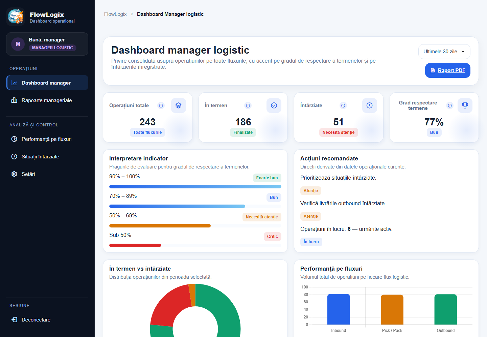
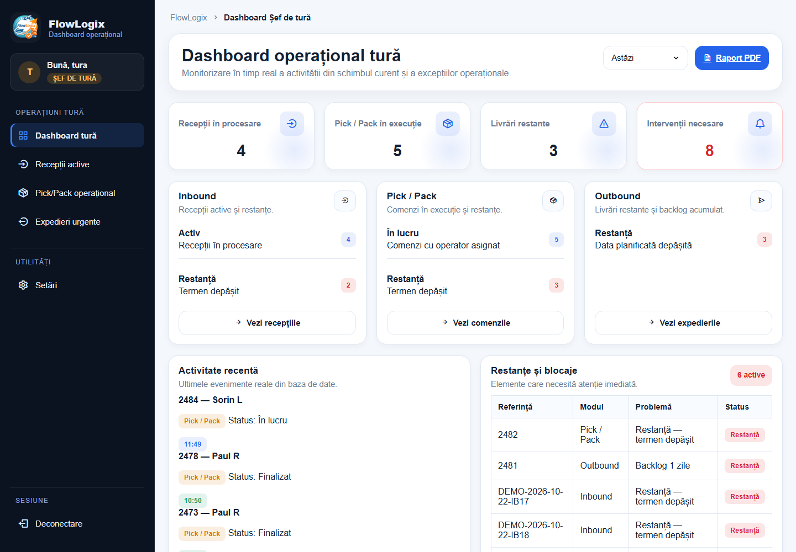
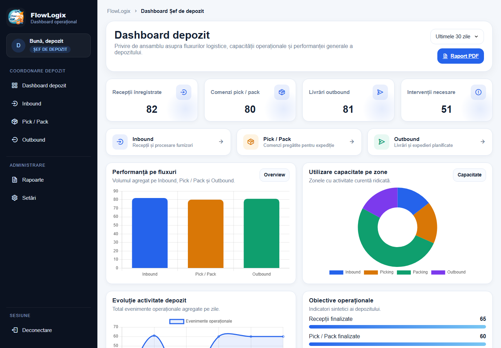
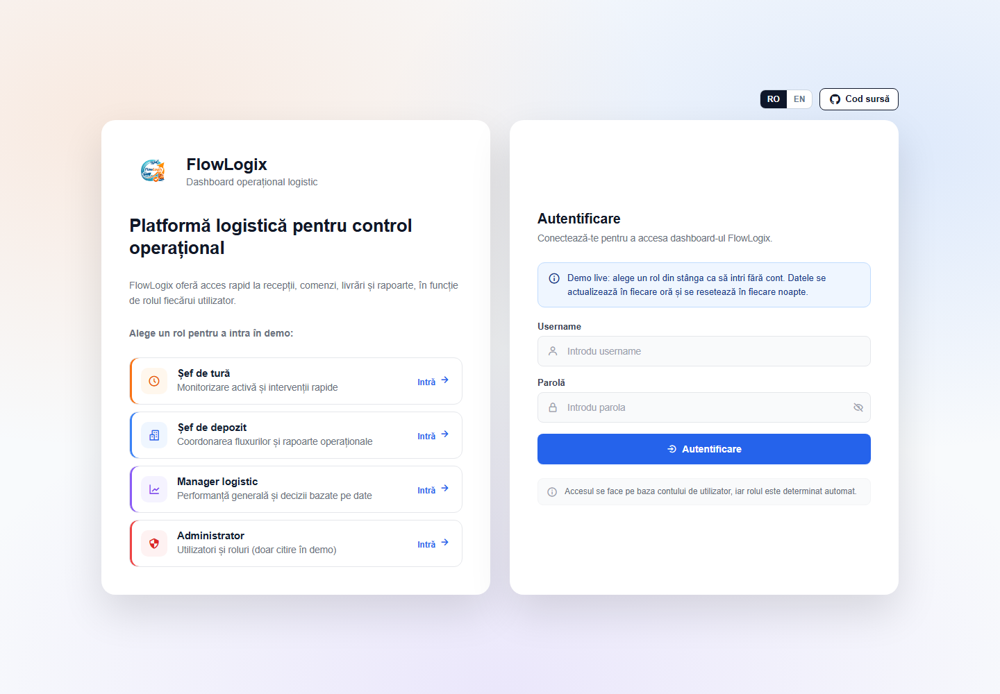
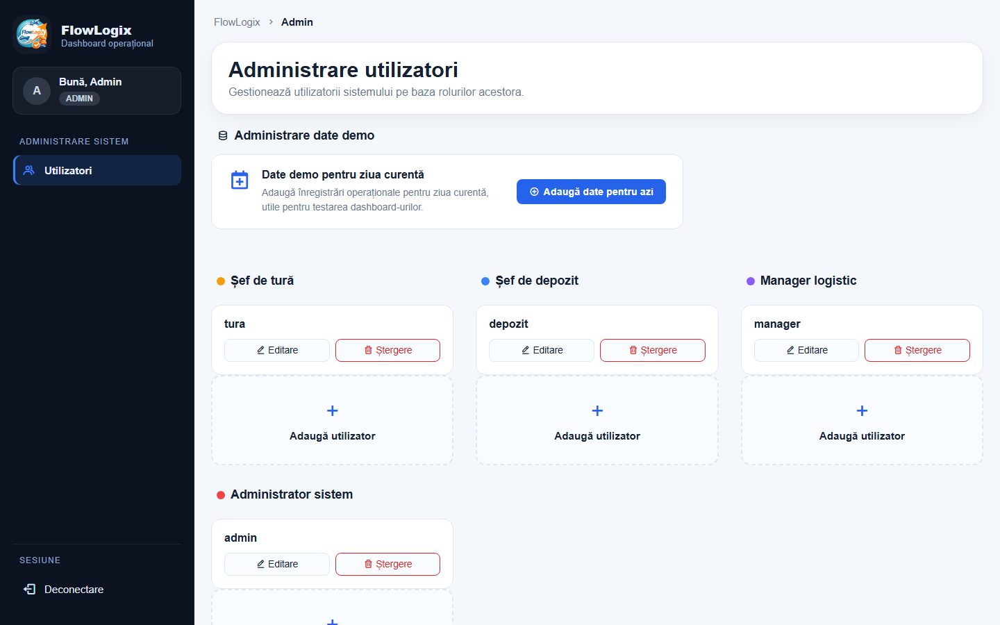
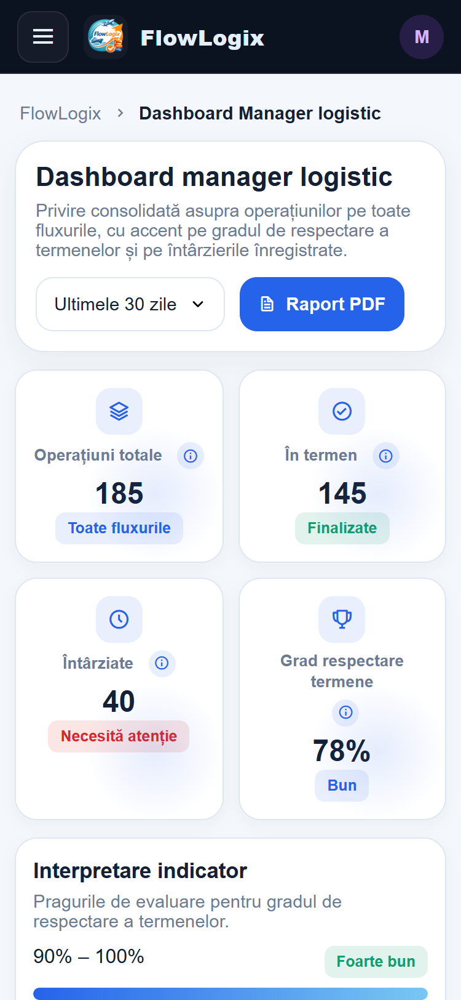
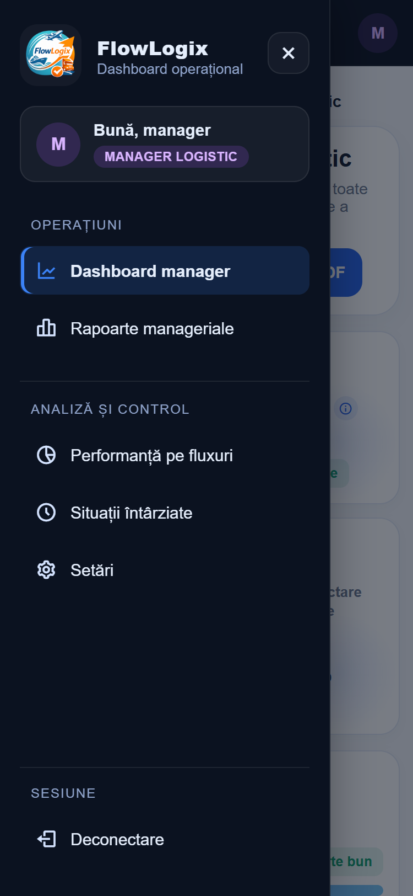
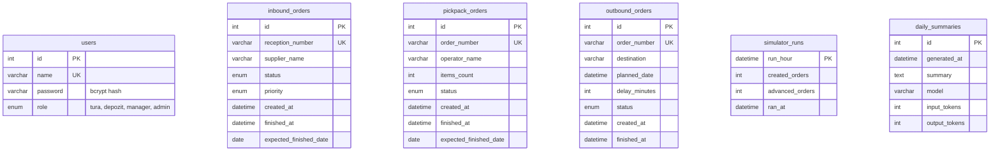

# FlowLogix

[](https://github.com/BogdanDumitrascu04/flowlogix/actions/workflows/ci-cd.yml)

A role-based dashboard for warehouse operations, built with PHP and MySQL.

In a warehouse, goods move through three flows: **inbound** (receiving), **pick & pack** (preparing orders) and **outbound** (shipping). Each person in the team needs a different view of these flows. A shift supervisor wants to see what is blocked right now, and a logistics manager wants to see how many operations were finished on time this month. FlowLogix shows each role the numbers and delays it needs.

This was my bachelor's thesis project (Business Informatics, Faculty of Economics and Business Administration, West University of Timișoara, 2026). The interface is in Romanian.

**Live demo:** https://flowlogix.polandcentral.cloudapp.azure.com. Pick a role card on the login page to enter with one click, or log in as `manager`, `depozit`, `tura` or `admin` with the password `demo123`. New orders arrive every hour, and the demo database is reset every night.



## Roles

| Role | Login | What the role sees |
|---|---|---|
| Shift supervisor (*șef de tură*) | `tura` | Active receptions, orders in progress, overdue shipments and blocked items in the current shift |
| Warehouse manager (*șef de depozit*) | `depozit` | Workload and backlog for each flow, warehouse reports |
| Logistics manager | `manager` | KPIs for all flows: on-time rate, delays, performance per flow, reports |
| Administrator | `admin` | User management (add, edit, delete) and demo data for the current day |

Each page checks the role saved in the session. A user who opens a page that belongs to another role gets a "403 Access denied" page.

## Features

- A dashboard for each role, with a period filter: today, last 7 days, last 30 days, current month
- Overdue and blocked items are calculated from the dates (`expected_finished_date`, `planned_date`), so there is no separate alerts table to keep in sync
- An hourly order simulator that keeps the demo data moving (see [Order simulator](#order-simulator))
- A short AI summary of the day on the manager dashboard, written by Claude Haiku from figures that SQL calculates (see [AI summary](#ai-summary))
- CSV exports and printable reports
- Charts with Chart.js
- Five color themes, saved in the browser
- Works on phones and tablets: below 900 px the sidebar becomes a menu that opens from the top bar, and long tables scroll inside their card

## Screenshots

| Shift supervisor | Warehouse manager |
|---|---|
|  |  |
| **Login** | **User administration** |
|  |  |

On a phone, the manager dashboard and the menu:

<p>
  
  
</p>

## Tech stack

- **Back end:** PHP 8 with MySQLi, no framework
- **Database:** MySQL 8
- **Front end:** HTML, CSS and vanilla JavaScript, Chart.js, Boxicons
- **Local server:** WampServer (Apache, PHP, MySQL)

## Database



Each flow has its own table. An order counts as **finished** when `finished_at` is set. It counts as **overdue** when it is not finished and its expected date (`expected_finished_date` or `planned_date`) has passed. `created_at` is indexed, because every period filter uses it.

## Run it locally

1. Install [WampServer](https://www.wampserver.com/) and copy this folder to `C:\wamp64\www\flowlogix`.
2. Open phpMyAdmin (`http://localhost/phpmyadmin`), create a database named `flowlogix` with the collation `utf8mb4_unicode_ci`, then import `database/flowlogix.sql`.
3. Copy `config.example.php` to `config.php`. The example uses the default WampServer settings (user `root`, no password); change them if yours are different.
4. Open `http://localhost/flowlogix/` and log in with one of the demo accounts.

Demo accounts: `admin`, `manager`, `depozit`, `tura`. The password for all of them is `demo123`. These are test accounts for the demo data only.

The demo data contains about 1,500 orders over four months. On import, the dates are moved forward so that the most recent day of activity is the day you import the file.

## Order simulator

There is no real warehouse system behind the demo, so `jobs/simulate_orders.php` plays that role. It is meant to run once an hour, between 06:00 and 22:00. Each run:

1. creates a few new orders in each flow (receptions, pick & pack orders, shipments);
2. moves open orders from the last two days forward: some are finished, some get an operator, and shipments that miss their planned time become delayed.

Everything in one run happens inside a single transaction, so an hour is either simulated completely or not at all. The table `simulator_runs` uses the hour as its primary key, so the database refuses to simulate the same hour twice, even if the job starts twice.

Run it by hand (`--force` also works outside working hours):

```
php jobs/simulate_orders.php --force
```

To run it every hour on Windows, create a task in Task Scheduler that starts `C:\wamp64\bin\php\php8.2.29\php.exe` with the argument `C:\wamp64\www\flowlogix\jobs\simulate_orders.php`. On a Linux server, a cron line does the same job:

```
0 * * * * php /var/www/flowlogix/jobs/simulate_orders.php
```

## AI summary

`jobs/daily_summary.php` writes a two or three sentence summary of the day for the logistics manager. It runs five times a day (09:15 to 21:15, every three hours):

1. MySQL calculates the figures of the day: receptions, pick & pack orders, shipments on time and late, and the destinations with most delays.
2. Only these aggregated figures (no names, no order details) are sent to Claude Haiku 5.5 through the official Anthropic PHP SDK, with an instruction to use only the given numbers.
3. The text is saved in `daily_summaries`, and the manager dashboard shows the latest one, labelled as written by AI.

The model never calculates anything: the numbers come from SQL, and the model only puts them into words. If the API key is missing or the call fails, nothing is saved and the dashboard keeps the previous summary. The key lives only in the server's `config.php`. Each run costs a fraction of a cent.

To try it locally, run `composer install` (the web pages do not need it), add `$anthropicApiKey = 'sk-ant-...';` to `config.php`, and run `php jobs/daily_summary.php`.

## Deployment

The live demo runs on a small Azure virtual machine with Ubuntu 24.04, Apache, PHP 8.3 and MySQL 8:

- the app is cloned from this repository into `/var/www/flowlogix`; the `database/` and `jobs/` folders cannot be opened from the browser
- MySQL uses a separate user that can only access the `flowlogix` database
- `config.php` on the server sets `$demoMode = true`: the role cards on the login page become one-click entries (`demo_login.php`), with an RO / EN switch and a link to the source code, and the user administration page is read-only, so one visitor cannot break the demo for the others. A local install keeps `$demoMode = false`
- cron runs the order simulator every hour and reloads the demo database every night at 03:15
- HTTPS uses a free Let's Encrypt certificate that renews automatically. Requests over plain HTTP, or to the server's IP address, are redirected to the HTTPS domain
- every push to `main` runs a GitHub Actions pipeline (`.github/workflows/ci-cd.yml`): it loads the demo data into a fresh MySQL 8 database, runs the order simulator, opens every page as each role (`tests/render_pages.sh`) and checks the CSRF tokens, the login limit and the CSV exports over HTTP (`tests/security_checks.sh`). Only if all of that passes does it update the server, using an SSH key that can run nothing except `deploy/flowlogix-deploy.sh`

Moving from WampServer to a standard MySQL server exposed two old bugs: a `GROUP BY` that only worked because WampServer's MySQL is permissive (`ONLY_FULL_GROUP_BY` is off there), and a byte order mark at the start of three PHP files. Both are fixed.

## Project structure

| Path | Purpose |
|---|---|
| `login.php`, `authenticate.php` | Login form and login check, with the limit on failed attempts |
| `csrf.php` | CSRF token for every form that changes something |
| `dashboard-*.php` | Home page for each role |
| `inbound.php`, `pickpack.php`, `outbound.php` | Detailed pages for each flow |
| `raport-*.php`, `rapoarte.php`, `export_report.php` | Reports and CSV exports |
| `admin.php` | User management |
| `sidebar.php`, `js/sidebar.js` | Menu shared by all pages; on phones and tablets it opens from the top bar |
| `css/`, `js/app.js` | Styles, color themes and responsive layout; charts and filters |
| `flow_helpers.php` | Shared functions: period filters, the `flx_query()` helper for prepared statements, the CSV row writer, status rules |
| `database/` | Schema with demo data, and the password migration script |
| `jobs/simulate_orders.php` | Hourly order simulator |
| `jobs/daily_summary.php` | AI summary of the day (Claude Haiku, Anthropic PHP SDK) |
| `tests/render_pages.sh` | Opens every page, period and export as each role and fails on any PHP error |
| `tests/security_checks.sh` | Sends real HTTP requests to check CSRF tokens, the login limit, the new session ID at login and the CSV formula guard |
| `.github/workflows/ci-cd.yml`, `deploy/` | Automatic tests and deployment to the live server |

## Improvements after the thesis

After the thesis, I fixed two weaknesses that I had listed as future work:

- **Passwords** were stored as plain text. They are now saved as bcrypt hashes with `password_hash()` and checked with `password_verify()`. The script `database/migrate_passwords.php` converted the existing users once. It skips passwords that are already hashed, so running it twice does no harm.
- **SQL queries** pasted the period filter into the SQL text. The period came from a fixed list, so it could not be used for SQL injection, but code and values were mixed in one string. Every period filter is now a prepared statement: `created_at BETWEEN ? AND ?`, with the two dates bound as parameters.

A later review of the live demo found five more problems, now fixed and checked on every push by `tests/security_checks.sh`:

- **Logout** only opened the login page and left the session alive, so the dashboards stayed reachable. It now goes through `deconectare.php`, which destroys the session.
- **CSRF**: every form that changes something (login, the demo role cards, user administration, demo data) sends a random token saved in the session (`csrf.php`). A page on another site can make the browser send the form, but it cannot read the token, so the request is refused. Adding today's demo data used to run from a plain link and is now a form too.
- **Failed logins**: after 5 wrong passwords from the same IP address in 15 minutes, `authenticate.php` refuses further attempts from that address without checking the password. Failures are stored in the `login_attempts` table.
- **Session fixation**: a successful login gives the browser a new session ID (`session_regenerate_id(true)`), so a session ID known to someone else before the login is useless after it.
- **CSV formula injection**: Excel runs a cell that starts with `=`, `+`, `-` or `@` as a formula. Exported text that starts this way gets an apostrophe in front and opens as plain text (`flx_csv_row()` in `flow_helpers.php`).

## How it was built

I designed FlowLogix: the roles, the flows and the KPIs come from my work as a team leader in a logistics warehouse. I wrote the code with the help of an AI coding assistant. I defined the requirements and the rules, and I reviewed and tested every change. I can explain any part of the code.
